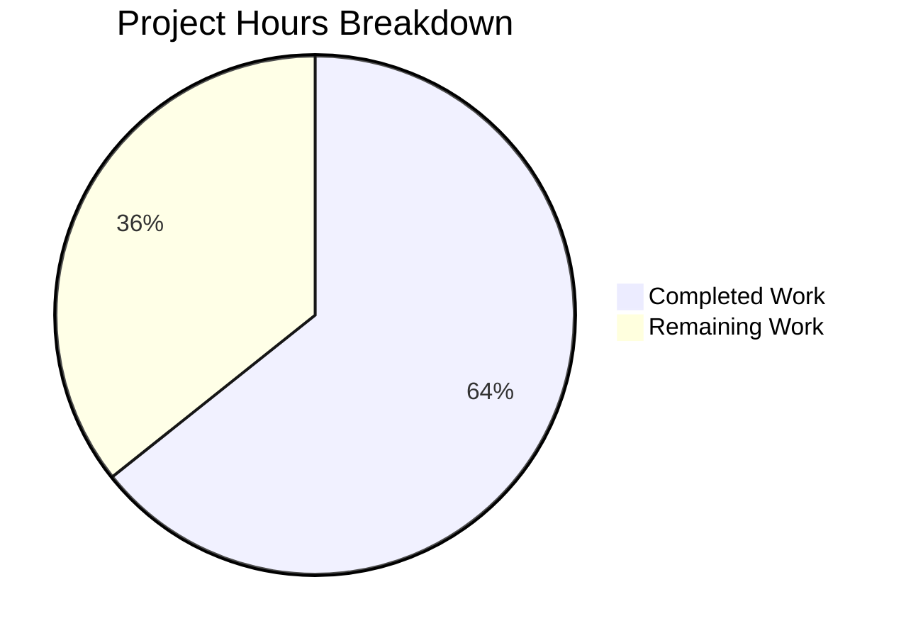
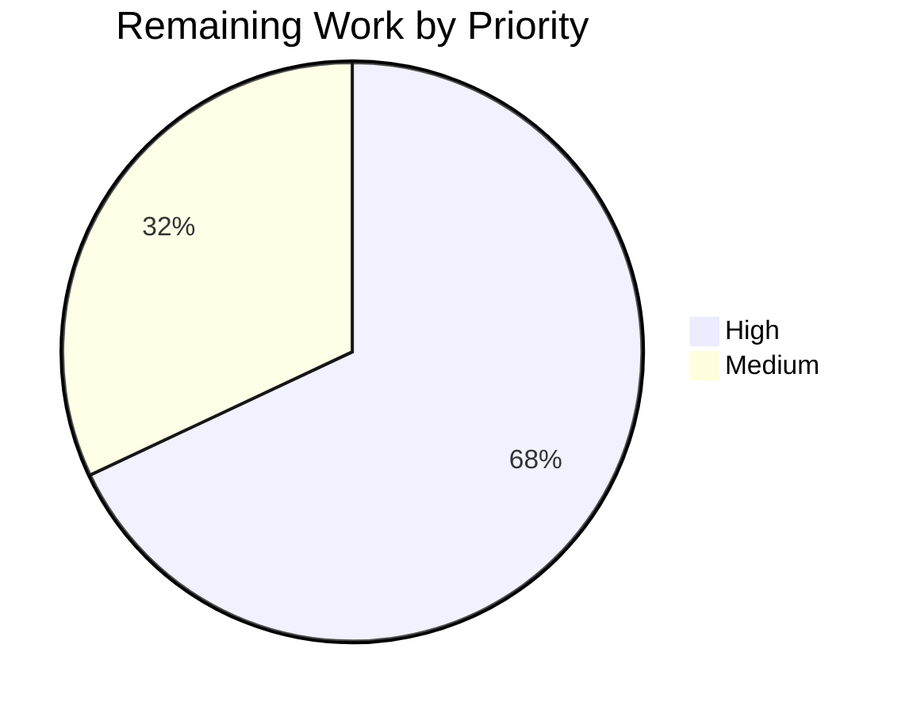
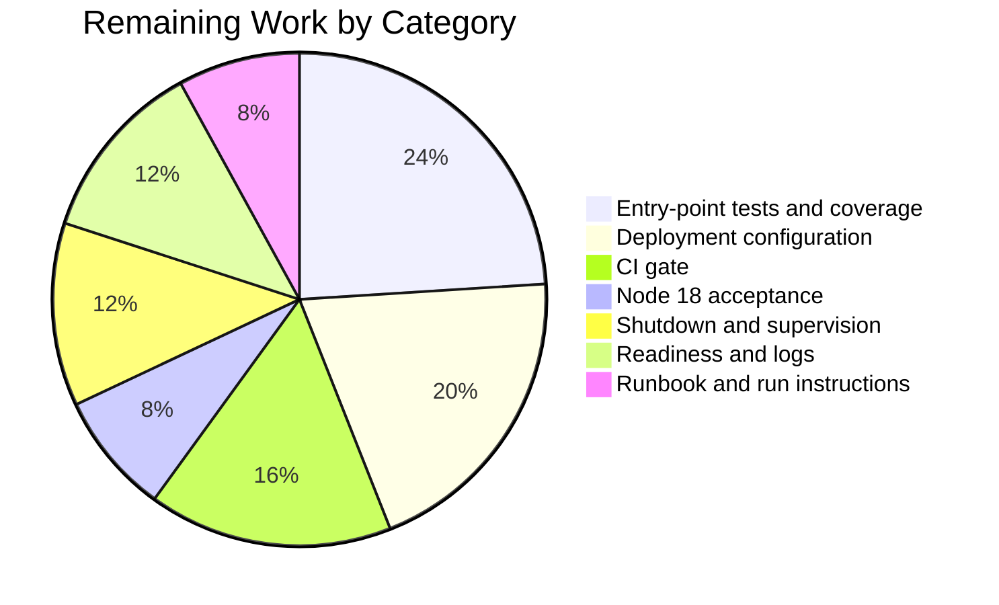

# 1. Executive Summary

## 1.1 Project Overview

An Express 5 HTTP service now sits in the repository root beside the existing Python module, answering `GET /` with `Hello world` and `GET /good-evening` with `Good evening`, both `text/plain; charset=utf-8`, and started by `npm start` on port 3000 or the port in `PORT`. It gives internal callers a small, dependency-light endpoint and this repository a tested Node service. Its contract suite proves each response row in full, proves that anything unmatched gets the framework's own default not-found page, and bounds every request so a stall fails rather than hangs. The Python module is untouched.

## 1.2 Completion Status



| Metric | Hours |
|---|---|
| Total Project Hours | 70 |
| Completed Hours (AI + Manual) | 45 |
| Remaining Hours | 25 |

**Completion: 45 / (45 + 25) = 64.3%, reported as 64%.** Every capability in scope was exercised; the remaining hours are path-to-production work the original scope excluded, plus one leg that cannot run here.

## 1.3 Key Accomplishments

- Both endpoints verified byte-for-byte on the default, overridden and empty port: 200, `text/plain; charset=utf-8`, 11- and 12-byte bodies.
- Express defaults preserved: unmatched paths and methods 404 with the framework's own page, automatic `HEAD`/`OPTIONS`, query ignored, case-insensitive non-strict routing.
- `PORT`: unset or empty means 3000, digits-only 1–65535 accepted, everything else refused with one escaped standard-error line and status 1 before any socket opens.
- Bind failure reported as one line and status 1, with no success line and the first server unaffected.
- Reproducible dependency tree: one dependency among 68 locked packages, `npm ci` green, no advisories.
- Contract suite of five subtests green at 6 of 6 and isolated from the listener, asserting each response row in full: status, content type, byte count, exact body and the default page's provenance.
- Every request bounded at 5 seconds so a stall fails the run; `submod.py` and `README.md` preserved byte-for-byte.

## 1.4 Critical Unresolved Issues

5 of the 21 acceptance checks this work was scoped against remain open or carried with a caveat.

| Issue | Impact | Owner | ETA |
|---|---|---|---|
| Node 18.20.8 and Node 18.1.0 acceptance runs not performed (1) | The specification's Node 18 figures are unconfirmed on that line | Platform engineering | Before release |
| Port-resolution and bind-failure paths have no automated test (1) | Regressions there rest on manual acceptance | Repository owner | Next change |
| No measured coverage figure in the project's own tooling (1) | The completeness of the five-case suite cannot be tracked over time | Repository owner | Next change |
| The two 404 provenance assertions pin `finalhandler` 2.1.1's marker headers (1) | A dependency bump would fail both rows for a reason unrelated to the contract | Repository owner | On the next dependency change |
| `engines.node` `>=18` while `npm test` needs Node 18.1.0 (1) | A consumer on exactly 18.0.0 sees a failing suite with nothing in the repository explaining it | Repository owner | Next change |

## 1.5 Access Issues

| System/Resource | Type of Access | Issue Description | Resolution Status | Owner |
|---|---|---|---|---|
| Node.js 18.x runtime | Toolchain availability | Node 18 may not be installed in this environment, so the specification's Node 18 acceptance legs could not be executed; its release artifacts were integrity-verified only | Open | Platform engineering |

No other access issues: the service is local and needs no credentials, database or external service.

## 1.6 Recommended Next Steps

1. [High] Add tests for the port-resolution and bind-failure paths inside the five-case discipline, and publish a coverage figure.
2. [High] Add a CI job running install, the parse checks and the suite on every change.
3. [High] Choose and implement the deployment target — host or container, binding scope, TLS termination.
4. [Medium] Run the suite once on Node 18.20.8 and once on 18.1.0 where permitted, and record the results.
5. [Medium] Add graceful shutdown, a readiness probe and the runbook, recording the Node 18.1.0 test floor.

# 2. Project Hours Breakdown

## 2.1 Completed Work Detail

| Component | Hours | Description |
|---|---|---|
| Express application module (`app.js`) | 3 | The two `app.get` routes with the explicit `text/plain` content type, the module-level contract header, and the export that lets the entry point and the suite share one application. |
| Process entry point and its diagnostics (`server.js`) | 6 | `PORT` resolution with named bounds and one validation function, the fail-fast invalid-`PORT` diagnostic and its escaping, the listen call with no host argument, the bind-failure branch and the post-bind success line. |
| Package manifest and lock (`package.json`, `package-lock.json`) | 2 | The hand-written manifest with the start and test scripts, the `engines` floor and the single dependency, plus the generated lock that pins the 68-package tree. |
| Repository hygiene and preservation verification (`.gitignore`, `submod.py`, `README.md`) | 3 | The single ignore rule that keeps the install tree out of version control, explicit-path staging, and byte-level confirmation that both pre-existing files are unchanged and that the Python module still runs. |
| Contract suite harness, isolation and teardown (`test/app.test.js`) | 8 | One parent test with five subtests on an ephemeral loopback port, socket tracking with a drain-and-settle teardown, the bind-failure branch that closes before rejecting, named bind constants, and the per-request timeout with the timed request helper that carries every request. |
| Contract assertion layer: the 200 rows and the 404 rows' provenance (`test/app.test.js`) | 6 | The full response row for each of the three 200 cases — status, un-redirected delivery, content type, the contract's own UTF-8 byte count checked before the body, and the exact body — and, for the two 404 cases, the default not-found page's status, content type, marker headers and contained message. |
| Suite documentation and clean-code pass (`test/app.test.js`) | 2 | A note at every module-scope binding, JSDoc for both assertion helpers and the request helper covering their parameters and return values, and one statement of the bind rationale. |
| Runtime acceptance of the response and lifecycle matrix | 7 | The success criteria exercised end to end: both routes on the default, an overridden and an empty port, the routing defaults, both failure states, the packaging gates, the mutation check, and the literal ports run inside a private network namespace. |
| Suite verification: mutation campaign and failure-mode injection | 3 | The suite attacked from outside by changing response strings, content types, statuses and lengths, by substituting a hand-rolled not-found response, by redirecting a route, by stalling a response and by forcing a test-server bind failure — each mutation restored and proven byte-identical. |
| Performance and security characterisation | 5 | Startup, latency, concurrency, memory and file-descriptor behaviour under sustained load, plus the payload sweeps over both endpoints, the default 404 surface and the process input. |
| **Total** | **45** | |

## 2.2 Remaining Work Detail

| Category | Hours | Priority |
|---|---|---|
| Automated coverage of the port-resolution and bind-failure paths, with coverage reporting | 6 | High |
| Deployment configuration: target, `PORT` binding scope and TLS termination | 5 | High |
| Continuous-integration gate over install, parse checks and the suite | 4 | High |
| Runtime acceptance on the Node 18 line | 2 | High |
| Production process management: graceful shutdown and supervision | 3 | Medium |
| Health or readiness endpoint and operational log integration | 3 | Medium |
| Operational runbook and repository run instructions, including the test floor | 2 | Medium |
| **Total** | **25** | |

## 2.3 Estimation Basis

Completed hours are measured against the standard categories — implementation, tests, integration and verification — and sized from the artifacts actually delivered and the runtime matrices actually executed. The contract-suite rows cover the hardening of one file: a harness that closes and drains before rejecting, a teardown that always settles, a per-request bound, an assertion layer that proves each response row and the default not-found page's provenance, and the documentation that goes with them. Remaining hours are task-level estimates rounded up to the half hour, each traceable to a named requirement or to the work required to run this service in production. Confidence is high for the completed items, which are observable in the tree and were exercised, and medium for the remaining items, whose size depends on the deployment target chosen. No low-priority work remains: the request-bounding work is complete and is counted among the completed hours.

# 3. Test Results

| Area / Category | Framework | Tests | Passed | Failed | Coverage | What This Proves |
|---|---|---|---|---|---|---|
| HTTP contract suite (`test/app.test.js`) | `node:test` (Node built-in) | 6 | 6 | 0 | `app.js` 100%, suite 98% lines (Node's experimental reporter) | Both endpoints, the ignored query string and both default not-found rows hold under strict equality, the default page's provenance is asserted, and a changed response string fails the run. |
| Detection under mutation | `node:test` over a mutated `app.js` | 2 | 2 | 0 | — | A changed response string fails the run with a non-zero exit, whether or not its length changed — `'Good Evening'` at 3 of 6 passing, `'Hello world!'` at 4 of 6. |
| Request bound under a stalled response | `node:test` over a never-responding route | 1 | 1 | 0 | — | A response that never arrives fails the run by itself in about 5.4 s instead of hanging it. |
| Endpoint contract on the live server | `curl` | 7 | 7 | 0 | — | Status, exact `text/plain; charset=utf-8` and byte-exact bodies for both routes, the query-carrying path, the case and trailing-slash variant, the bodiless `HEAD`, the automatic `OPTIONS` body, and the default port refusing once the service stops. |
| Default not-found surface | `curl` | 2 | 2 | 0 | — | An unmatched path and an unmatched method answer 404 with the framework's own page, carrying `Cannot GET /no-such-path` and `Cannot POST /good-evening` plus `X-Content-Type-Options: nosniff` and `Content-Security-Policy: default-src 'none'`. |
| Port resolution and the invalid-value path | process runs | 5 | 5 | 0 | — | Unset, empty and `4000` each resolve and serve both routes, the overridden port serves while 3000 refuses, and `PORT=abc` is refused with one standard-error line, status 1 and no socket file. |
| Bind-failure handling | process runs against a held port | 2 | 2 | 0 | — | A second start exits 1 with the `EADDRINUSE` line and prints no liveness line, on the held port and on the default one. |
| Packaging and preservation gates | npm gates, hashes and the Python run | 7 | 7 | 0 | — | The lock reproduces the installed tree with no advisories, the manifest declares one dependency and no dev dependencies, and both pre-existing files hash to their recorded values and still run. |

**Not Covered**

- The port-resolution and bind-failure paths of `server.js` have no automated test: the suite is fixed at the five endpoint cases, so those branches are proved by the runtime probes above and by manual acceptance.
- The suite's own bind-failure branch (`test/app.test.js:89-97`) is not reached by a passing run; the coverage reporter shows it as the file's only uncovered range, exercised by fault injection only.
- The automatic `HEAD` and `OPTIONS` responses and the case and trailing-slash variants are exercised by hand and asserted by no test.
- No coverage threshold or tooling is configured in the project: the percentages above come from Node's own experimental reporter and are informational rather than a gate.
- The suite has not been executed on a Node 18 interpreter, so its documented runtime floor is unconfirmed on that line; the API surface it uses was checked against that release's exports.
- No external integration exists, so nothing of that kind is left uncovered.

# 4. Runtime Validation &amp; UI Verification

- ✅ **Server startup** — `npm start` prints exactly one `Listening on port <port>` after the bind; one listener owned by the node process; reachable on `localhost`, `127.0.0.1` and `[::1]`.
- ✅ **Both endpoints** — 200 with the exact bodies and content type, verified byte-for-byte on the default port, on an overridden port and with `PORT` empty.
- ✅ **Routing defaults** — 404 for unmatched paths and methods, automatic `HEAD` (zero body bytes) and `OPTIONS` (`Allow: GET, HEAD`, body `GET, HEAD`), query strings ignored, case-insensitive and non-strict matching.
- ✅ **Port override and resolution** — `PORT=4000` serves both routes while port 3000 refuses (curl exit 7); unset or empty resolves to 3000 rather than a random port.
- ✅ **Invalid `PORT`** — one escaped standard-error line, exit status 1, no socket file and no listener, through both `node server.js` and `npm start`.
- ✅ **Bind failure** — a second start writes `Cannot listen on port <port>: listen EADDRINUSE...` and exits 1 with no success line while the first server keeps answering.
- ✅ **Bounded requests** — with a route that never responds, `npm test` fails by itself in about 5.4 s (`This operation was aborted`, 4 of 6 passing) instead of hanging, and the suite's duration stays around 0.2 s on the delivered routes.
- ✅ **Packaging** — `npm ci` installs the locked 68-package tree, the installed tree matches the lock, `npm ls --all` exits 0 and the audit reports no vulnerabilities.
- ✅ **Python module coexistence** — `python3 submod.py` prints `Hello Blitzy User, From Wulf 2`, no JavaScript file references it, and the test runner never collects it.
- ✅ **Long-running behaviour** — sustained concurrent load over both endpoints with no errors, timeouts or body mismatches; memory plateaus and file descriptors return to the idle count.

Never exercised at runtime: there is no HTML page, view or client asset and no authentication, so no user-interface or accessibility surface exists to drive; the suite has not been run on a Node 18 interpreter; the suite's own bind-failure branch is reached only by fault injection; and no deployment runtime — process supervisor, reverse proxy or TLS terminator — was exercised, because none is part of the deliverable.

# 5. Compliance &amp; Quality Review

## 5.1 Compliance Matrix

| Deliverable | Benchmark It Was Held To | Status |
|---|---|---|
| Endpoint contract (`GET /`, `GET /good-evening`) | Functional correctness against the stated contract | ✅ Pass |
| Content type and byte-exact bodies | Response interface compliance | ✅ Pass |
| Routing defaults (query strings, unmatched path and method, `HEAD`, `OPTIONS`, case and trailing-slash variants) | Behavioural compliance with the framework defaults the specification fixed | ✅ Pass |
| Default not-found response and its provenance | Failure-path contract compliance | ✅ Pass |
| `PORT` resolution (`server.js:51-65`) | Input validation at the process boundary | ✅ Pass |
| Invalid-`PORT` diagnostic (`server.js:86-113`) | Fail-fast correctness and log integrity | ✅ Pass |
| Bind-failure handling (`server.js:119-126`) | Failure-path correctness and exit-status discipline | ✅ Pass |
| Startup and output discipline (`server.js:119-126`) | Process observability: one line per state, on the right stream | ✅ Pass |
| Module structure and module system | CommonJS, one responsibility per module, no middleware or non-default settings | ✅ Pass |
| Manifest and lock | Reproducible dependency resolution | ✅ Pass |
| Repository hygiene and preservation | Version-control discipline and non-regression of the pre-existing files | ✅ Pass |
| Automated contract suite | Test sufficiency against the delivered contract | ⚠️ Partial — each response row is now asserted in full and a stalled request fails the run, but the port-resolution and bind-failure paths and the routing defaults are not asserted, and no coverage threshold is configured |

## 5.2 AAP & Rule Divergences and Gaps

| What the AAP/Rule Required | What Was Delivered Instead | Why It Diverged | Impact | Remediation |
|---|---|---|---|---|
| The test file's harness and assertion table, fixed row by row | A harness that closes and drains before rejecting a bind failure, a teardown that always settles, a 5000 ms bound on every request, and 404 rows that assert the default page in full (`test/app.test.js:68-73, 85-140, 216-260`) | Sanctioned — the pull request's own review feedback asked for the pull request to be improved without widening its scope, and it outranks the specification; the changes stay inside the same five cases | The suite detects what it claims: a stalled response fails instead of hanging, and a look-alike 404 cannot satisfy either 404 case | None required; only the specification's test-file paragraph and its five-row table would need restating |
| Every identifier the test file introduces is enumerated in a variable table | Eight further identifiers, each documented at its declaration in the file's comments (`TEST_SERVER_PORT` 50, `TEST_SERVER_HOST` 54, `HTTP_OK` 60, `HTTP_NOT_FOUND` 63, `TEXT_HTML_UTF8` 66, `REQUEST_TIMEOUT_MS` 73, `request` 172, `assertNotFoundResponse` 246) | Sanctioned — the same feedback permits the machinery, and no separate documentation file is allowed, so the file's comments are the only home for the detail | A reader finds the detail in the code rather than in a table; nothing is undocumented | None required |
| The test file has one assertion helper | Two assertion helpers and one request helper, each with JSDoc for its parameters and return value (`test/app.test.js:172, 216, 246`) | Sanctioned — the full response row and the 404 provenance each need their own helper, and the feedback authorises both | Two more functions to maintain, each with one responsibility | None required |
| The invalid-`PORT` branch calls `process.exit(1)` | `process.exitCode = 1` after the diagnostic is written (`server.js:103-113`) | A forced exit abandons the pending write once the kernel has taken one 64 KiB pipe buffer, cutting the one-line diagnostic short, while the same specification fixes the observable requirement: one line on standard error, status 1, no socket opened | The process now ends once the line has drained; exit status, message and the absence of a bind are unchanged | None required; only the specification's sentence would need restating |
| The entry point carries one function, `resolvePort(value)` | A second function, `escapePortValue`, renders the echoed value (`server.js:86-91`) | The raw `PORT` value is interpolated into the diagnostic, so a line break inside it would produce a line identical to the success line | Values carrying control characters, quotes or backslashes print escaped; ordinary values are byte-identical to the specified text | None required |
| Acceptance on the isolated Node.js 18.20.8 runtime | Everything validated on Node.js 20.20.2 with npm 10.8.2 | The platform restriction attached to this repository forbids Node 18 and mandates that runtime, and it outranks the specification | The specification's Node 18 figures remain unconfirmed on that line; `engines.node` still declares `>=18` | Run the suite once on 18.20.8 and once on 18.1.0 where Node 18 is permitted (2 h) |
| `engines.node` `>=18` with `"test": "node --test"` should support Node 18 throughout | Both values delivered as fixed, so Node 18.0.0 cannot run the suite (`node: bad option: --test`, exit 9) | Both values were fixed by the request and no pinning file may be added | A consumer on exactly 18.0.0 sees a failing test script with nothing in the repository explaining it; the real floor is 18.1.0 | Record the floor in the repository or raise the declared range (part of the runbook task) |
| The suite proves the delivered contract, with the file and dependency sets closed | Five endpoint cases, so the port-resolution and bind-failure paths and the routing-default behaviours are unasserted | The specification fixed the suite at five cases and closed the file and dependency sets; the review feedback forbids a sixth case | An entry-point regression would not fail the build; those paths are proved only by the acceptance probes | Add server-side tests in a later change (6 h) |

**The hardened suite.** The test file was specified with a fixed harness and a table in which the two 404 rows assert only a status code. The review feedback attached to this pull request asked for the pull request to be improved without widening its scope, which outranks the specification, so the file now closes server and drains sockets before rejecting a bind failure (`test/app.test.js:89-97`), settles teardown on any close-callback argument (`test/app.test.js:129-140`), bounds every request at five seconds through one timed helper (`test/app.test.js:68-73, 172-192`) and asserts each 200 row in full and each 404 row's default-page provenance (`test/app.test.js:216-260`). The five case names, the five-case structure and the mutation profile are unchanged: `'Good Evening'` still fails three subtests and `'Hello world!'` two, each with a non-zero exit. No action is needed unless the specification's test-file paragraph is to be restated to match.

**The identifier set.** The specification's variable table enumerated every identifier the test file introduces, and the file now declares eight more. Each is documented where it is declared — the bind port and host, the two status codes, the two content types and the request bound as named constants with a note apiece, and both helpers with JSDoc covering their parameters and return values. The detail belongs in the file's own comments because the specification forbids any file outside the agreed set and forbids editing the readme, so there is nowhere else for it to live. A reader looking for the meaning of `REQUEST_TIMEOUT_MS` finds both the value and the reason for it at the declaration; nothing has been left undocumented.

**The helpers.** The specification's clean-code statement records a single assertion helper. The file has three: two assertion helpers and one request helper. The 200 rows and the 404 rows assert different things — the first a full response row including the contract's own byte count, the second the default not-found page's status, content type, marker headers and contained message — so sharing one helper would mean passing a mode flag through it, and routing every request through one timed helper is what makes the request bound total rather than per-case. Each function carries one responsibility and its own documentation, and the five subtests read as five lines each.

**The exit mechanism.** The specification's prose for the entry point says the invalid-`PORT` branch should force the exit, but the same specification states the observable requirement: one line on standard error, exit status 1, before any socket is opened. A forced exit is what cuts that line short — with standard error on a pipe the write is asynchronous, so the process leaves after the kernel has taken one 64 KiB buffer, delivering 65,536 of 70,083 bytes and losing the trailing line feed, while the same value written to a file arrives whole. The branch therefore sets the exit status and lets the line drain (`server.js:107-113`); the value is still refused before any bind, `app.listen` is still never called on that path, and ordinary values such as `abc` still produce the specified message byte for byte.

**The escaping helper.** The entry point was specified with a single function, yet the diagnostic interpolates the raw `PORT` value, and that value is the process's own input. Interpolating it unchanged lets a line break inside it produce a standard-error line reading exactly `Listening on port 3000` — indistinguishable from the success line the process writes after a bind — which defeats any liveness check that watches the log. Escaping the value removes that, and the escaping needs a home, so `escapePortValue` was added as a documented pure function beside the resolver (`server.js:86-91`) rather than inlined into the message. For values carrying control characters, quotes or backslashes the echoed text shows escapes; every ordinary value is unchanged, and no character is dropped.

**The validation runtime.** Every install, build, test and runtime check ran on Node.js 20.20.2 with npm 10.8.2 rather than the Node.js 18.20.8 the specification names. The restriction attached to this repository forbids Node 18 outright and mandates the 20.20.2 runtime, and it outranks the specification; npm is the version the specification itself chose to generate the lock, and no delivered file uses an API that differs between the lines, so the manifest keeps `engines.node` at `>=18`. The practical consequence is narrow and worth closing: the expected Node 18 figures are unconfirmed on that line. The suite's API surface was checked against that release's exports, so the floor is real; it is simply unobserved. One run on each of those two interpreters closes it.

**The Node floor.** `engines.node` declares `>=18` and the test script is `node --test`, which arrived in Node 18.1.0. On exactly 18.0.0 the script therefore fails with `node: bad option: --test` and exit status 9 — the application starts, but the suite does not run. Both values were fixed by the request and no `.nvmrc` or other pinning file may be added, so the pair was delivered as asked; the real supported floor for `npm test` is Node 18.1.0, and nothing in the repository states it. Recording it in the runbook, or raising the declared range to `>=18.1`, closes this with no code change once the file set is reopened.

**The unasserted server-side paths.** The suite was fixed at five endpoint cases, and the file and dependency sets were closed, so nothing asserts the port-resolution rules, the fail-fast diagnostic, the bind-failure branch, or the `HEAD`, `OPTIONS`, case-insensitive and trailing-slash behaviours. That is a scope decision rather than an omission — the specification says so explicitly and the review feedback forbids a sixth case — but it is the largest verification gap in the delivered system: a change to `server.js` would not fail the build. Those paths are currently proved by the acceptance probes recorded above, which exercise them directly, and the six-hour task in Section 2.2 makes the proof automatic.

# 6. Risk Assessment

| Risk | Category | Severity | Probability | Mitigation | Status |
|---|---|---|---|---|---|
| No automated test covers the entry point: a change to the port rules, the fail-fast diagnostic or the bind-failure branch would not fail the build | Technical | Medium | Medium | Add server-side tests inside the five-case discipline and publish a coverage figure | Open |
| The two 404 provenance assertions pin `finalhandler` 2.1.1's marker headers, so a dependency bump would fail both rows for a reason unrelated to the contract | Technical | Low | Low | Revisit the two 404 rows when the dependency is next moved; the lock bounds the exposure | Accepted |
| The listener binds every interface because the listen call passes no host argument | Security | Medium | High | Pass a host argument, or front the service with a proxy, where the deployment requires loopback-only | Accepted, by design |
| No authentication and no transport encryption on the served routes | Security | Low | High | Terminate TLS at a reverse proxy; both routes serve fixed public text | Accepted, by design |
| No continuous-integration gate: a change can land without install, parse or suite checks | Operational | Medium | Medium | Add a job that installs the locked tree, runs the parse checks and runs the suite on every change | Open |
| No graceful shutdown: a supervisor's termination signal ends the process and drops in-flight requests | Operational | Low | High | Handle the signal and close the server cleanly in a later change | Accepted |
| No health or readiness endpoint, so a platform can only probe the listening socket | Operational | Low | Medium | Add a readiness route and wire the startup diagnostic into the platform's logs | Open |
| The declared `engines.node` `>=18` disagrees with the real test floor of Node 18.1.0 | Integration | Low | Medium | Record the floor in the repository or raise the declared range | Open |

# 7. Visual Project Status


The **Completed Work** segment is the project's dark blue (#5B39F3) and **Remaining Work** the white (#FFFFFF) segment: 45 hours against 25, which is the 64% completion reported in Section 1.2.



| Status | Hours | Share |
|---|---|---|
| Completed — delivered and verified | 45 | 64% |
| Remaining — High priority | 17 | 24% |
| Remaining — Medium priority | 8 | 12% |



# 8. Summary &amp; Recommendations

**What was delivered.** The repository carries a small, complete Node.js service beside the existing Python module: an Express 5 application with two plain-text routes, a process entry point that resolves and validates the listening port, a fail-fast diagnostic for an invalid value, a bind-failure branch, a reproducible 68-package dependency tree, and a five-case contract suite that now asserts each response row in full and proves that an unmatched path or method is answered by the framework's own default not-found page. Every capability the work was scoped against exists in the tree, and each one was exercised: both endpoints byte-for-byte on the default, an overridden and an empty port, the routing defaults, the full invalid-value matrix and the bind-failure path, the packaging gates, and the preservation of the two pre-existing files. Against that scope the work is 45 of the 70 hours in Section 1.2 — **64% of the total project**, the balance being path-to-production work the original scope excluded.

**What was exercised to prove it.** The suite is green at 6 of 6 in about 0.2 s and fails whenever a response string changes, whether or not its length does, so the contract is protected rather than merely satisfied. Each assertion was shown to bite: a wrong status, a wrong content type, an extra byte and a same-length change each fail the case that owns it; a hand-rolled not-found response copying the status, the type and the text still fails both 404 cases on the marker headers only the default page carries; and a route that never answers now fails the run by itself in about five seconds instead of hanging it. The live service was driven over both routes, the 404 surface, the automatic methods and the routing variants, and the packaging and preservation gates were run in full.

**What remains.** The remaining 25 hours are dominated by three items: automated tests for the port-resolution and bind-failure paths with a measured coverage figure (6 h), a deployment target with its binding scope and TLS termination decided (5 h), and a continuous-integration gate (4 h). The rest is operational polish — the Node 18 acceptance runs (2 h), graceful shutdown and supervision (3 h), a readiness probe with log integration (3 h), and the runbook, which is also where the real Node 18.1.0 test floor belongs (2 h). None of these is a defect in what was delivered; each is work the service needs before it runs in production under someone else's supervision.

**Critical path to production.** The shortest credible route is: add the entry-point tests so the process boundary is covered before it is touched again; add the integration gate so every later change is verified automatically; decide the deployment target and bind the service explicitly there, terminating TLS in front of it; then add the shutdown handling and the readiness probe the platform will expect. The Node 18 acceptance run can happen in parallel and is the only outstanding item that closes a promise made in the original scope rather than preparing for operations.

**Success metrics and readiness.** The service meets its stated contract on every exercised path: 200 with the exact bodies and content type, 404 with the framework's own page for anything unmatched, one diagnostic line and status 1 for an invalid port, one success line after a bind, and a dependency tree that installs reproducibly with no advisories. Under load it answered sustained concurrent requests with no errors or body mismatches and returned its file descriptors to the idle count. The application logic is production-ready and verified; the operating envelope around it is not yet built. Before this service takes real traffic, a reviewer should expect a continuous-integration gate, tests for the entry-point paths, an explicit decision on which interfaces the listener binds and where TLS terminates, a shutdown path a supervisor can use, and a readiness probe — all listed in Section 2.2 with hours. Until then it is ready to run on a trusted network, watched by a human, which is the shape the original scope asked for.

# 9. Development Guide

### System prerequisites

- **Node.js 18.1.0 or newer.** The suite needs the `node --test` runner, which arrived in 18.1.0; the application itself runs on 18.0.0 and later. The tree was validated on Node.js 20.20.2.
- **npm** (validated with 10.8.2, the version the lock was generated with).
- **Python 3** for the pre-existing `submod.py` (validated with CPython 3.12.3). No Python packages are needed: the module imports nothing.
- **curl** for the manual checks, and **lsof** if you need to find the process holding a port.

```bash
node --version     # v18.1.0 or newer
npm --version
python3 --version  # Python 3.x
```

### Environment setup

There is nothing to configure. The service reads one optional environment value, `PORT`, and defaults to 3000. Every command below is run from the repository root.

### Dependency installation

```bash
npm ci --no-audit --no-fund
```

Expected: `added 68 packages`. This installs `express@5.2.1` and its transitive set exactly as `package-lock.json` pins them, and leaves both manifest files byte-identical. Run `npm install --no-audit --no-fund` instead only if you have deliberately changed `package.json`, since a plain install is what regenerates the lock.

### Build and parse checks

This project has no compile step; the equivalent checks are:

```bash
node --check app.js && node --check server.js && node --check test/app.test.js
python3 -W error -m py_compile submod.py && rm -rf __pycache__
```

Expected: both commands print nothing and exit 0.

### Running the test suite

```bash
npm test
```

Expected output ends with:

```text
# tests 6
# suites 0
# pass 6
# fail 0
# cancelled 0
# skipped 0
# todo 0
# duration_ms 214.5
```

The suite starts the application on an ephemeral loopback port, so it is safe to run while a server holds port 3000, and it never loads `server.js`, so no configured port is bound during the run. Each case asserts the whole response row: for the three 200 cases the status, the absence of a redirect, the exact `Content-Type`, the contract's own UTF-8 byte count and the exact body; for the two 404 cases the status, the exact `Content-Type`, the two marker headers only Express's default not-found page carries, and the message inside that page. A changed response string fails the run whether or not its length changes. Every request carries a five-second bound, so a response that never arrives fails the suite instead of hanging it:

```bash
node --experimental-test-coverage --test   # optional: informational line coverage
```

Expected: `app.js` at 100% of lines, the suite at about 98%, and the suite's bind-failure branch as its only uncovered range. No threshold is configured, so this is a reading rather than a gate.

### Starting the application

Foreground, on the default port:

```bash
npm start
# > hello-world-py@1.0.0 start
# > node server.js
# Listening on port 3000
```

Detached, on a port of your own, with the log captured and the pid printed:

```bash
PORT=4000 nohup npm start > server.log 2>&1 & echo $!
```

If that port is already in use, pick another. To stop the service, stop the process that owns the port, not just the npm parent:

```bash
kill "$(lsof -ti tcp:4000 -sTCP:LISTEN)"
```

### Verifying the service

```bash
curl -i http://localhost:4000/
```

Expected:

```text
HTTP/1.1 200 OK
X-Powered-By: Express
Content-Type: text/plain; charset=utf-8
Content-Length: 11
...
Hello world
```

```bash
curl -i http://localhost:4000/good-evening      # 200, text/plain; charset=utf-8, Good evening
curl -i http://localhost:4000/good-evening?name=x  # the same response; query strings are ignored
curl -i http://localhost:4000/good-morning      # 404, text/html; charset=utf-8, Cannot GET /good-morning
curl -i -X POST http://localhost:4000/good-evening  # 404, Cannot POST /good-evening
curl -I http://localhost:4000/                  # 200 with the GET headers and no body
curl -i -X OPTIONS http://localhost:4000/       # 200, Allow: GET, HEAD, body GET, HEAD
```

Failure paths, each of which exits with status 1 and prints one line to standard error:

```bash
PORT=abc npm start      # Invalid PORT "abc": expected a whole number from 1 to 65535
test ! -e abc           # no socket file is created for a non-numeric value
npm start               # with a server already holding the port:
                        # Cannot listen on port 4000: listen EADDRINUSE: address already in use :::4000
```

The Python module, unchanged and still runnable:

```bash
python3 submod.py       # Hello Blitzy User, From Wulf 2
```

Packaging gates:

```bash
npm ls --all                              # exit 0, one top-level dependency
npm audit --omit=dev                      # found 0 vulnerabilities
node -e "const l=require('./package-lock.json');const bad=Object.entries(l.packages).filter(([p,e])=>p&&require('./'+p+'/package.json').version!==e.version);console.log(bad.length?'MISMATCH':'installed tree matches lock', l.packages['node_modules/express'].version, l.packages[''].dependencies.express)"
# installed tree matches lock 5.2.1 ^5
git diff --exit-code -- submod.py README.md   # exit 0 while the pre-existing files stay untouched
```

### Example session

```bash
npm ci --no-audit --no-fund
npm test                                  # 6 of 6 passing
PORT=4000 nohup npm start > server.log 2>&1 & echo $!
curl -s http://localhost:4000/            # Hello world
curl -s http://localhost:4000/good-evening # Good evening
PORT=abc node server.js; echo "exit=$?"   # the diagnostic line, then exit=1
kill "$(lsof -ti tcp:4000 -sTCP:LISTEN)"
```

### Troubleshooting

| Symptom | Cause | Resolution |
|---|---|---|
| `Error: Cannot find module 'express'` from `npm test` or `npm start` | Dependencies are not installed | Run `npm ci --no-audit --no-fund` from the repository root |
| `node: bad option: --test` | Node 18.0.0 is in use, and the test runner arrived in 18.1.0 | Use Node 18.1.0 or newer for `npm test`; the application itself runs on 18.0.0 |
| `Cannot listen on port <port>: listen EADDRINUSE` | Another process holds the port | `lsof -ti tcp:<port> -sTCP:LISTEN` then stop that process, or choose another `PORT` |
| `Invalid PORT "<value>": expected a whole number from 1 to 65535` | The value is not digits-only within 1–65535 | Pass a plain decimal port; leading zeros are fine, signs, spaces, decimals, exponents and hex are not |
| The port stays bound after stopping the service | The npm parent was killed and the node child kept the socket | Stop the process that owns the port, as above |
| `node_modules/` appears in `git status` | The command ran outside the repository root, or the ignore file was changed | Run from the repository root; `.gitignore` must contain the single line `node_modules/` |
| `__pycache__/` appears as an untracked directory | You imported or byte-compiled the Python module | Expected: the ignore file deliberately lists only `node_modules/`; delete the directory after checking |
| `npm test` takes about five seconds and one or two subtests fail with `This operation was aborted` | The application did not answer within the request bound, which is working as designed | Treat it as a stalled response in the change under test, not as a suite defect; the delivered routes answer in milliseconds |
| A single 404 case fails with `expected: 'nosniff' / actual: null` | Something other than Express's default not-found page is answering that path | Check for a route, a not-found handler or middleware that intercepts the path; the default page is the contract |

# 10. Appendices

### A. Command Reference

| Purpose | Command |
|---|---|
| Install the locked dependency tree | `npm ci --no-audit --no-fund` |
| Parse-check the JavaScript files | `node --check app.js && node --check server.js && node --check test/app.test.js` |
| Parse-check the Python module | `python3 -W error -m py_compile submod.py && rm -rf __pycache__` |
| Run the contract suite | `npm test` |
| Report line coverage (informational) | `node --experimental-test-coverage --test` |
| Start the service | `npm start` (or `PORT=4000 nohup npm start > server.log 2>&1 & echo $!`) |
| Verify both routes | `curl -i http://localhost:<port>/` and `curl -i http://localhost:<port>/good-evening` |
| Verify the 404 cases | `curl -i http://localhost:<port>/good-morning` and `curl -i -X POST http://localhost:<port>/good-evening` |
| Verify the automatic methods | `curl -I http://localhost:<port>/` and `curl -i -X OPTIONS http://localhost:<port>/` |
| Stop the service by its port owner | `kill "$(lsof -ti tcp:<port> -sTCP:LISTEN)"` |
| Inspect the dependency tree | `npm ls --all` |
| Check for advisories | `npm audit --omit=dev` |
| Check the installed tree against the lock | the lock-match one-liner in the Development Guide |
| Run the Python module | `python3 submod.py` |
| Confirm the pre-existing files are untouched | `git diff --exit-code -- submod.py README.md` |
| List the tracked files | `git ls-files` |

### B. Port Reference

| Port | Source | Notes |
|---|---|---|
| 3000 | Default when `PORT` is unset or empty | The documented default; an empty value does not fall through to a random port |
| 1–65535 | `PORT`, when it is ASCII digits and nothing else | Validated before any socket opens; leading zeros are arithmetic (`04000` is 4000) |
| An operating-system-chosen port | The test suite's listen call on port `0` | Loopback only, so the suite never occupies the configured port |

The listener passes no host argument, so the service binds every interface and `http://localhost:<port>` reaches it.

### C. Key File Locations

| Path | Contents |
|---|---|
| `app.js` | The Express application: the two routes, the explicit content type, and the export; never listens |
| `server.js` | The process entry point: `PORT` resolution, the invalid-value diagnostic, the listen call, both failure and success output |
| `test/app.test.js` | The `node:test` contract suite: five subtests under one parent, ephemeral loopback port, bounded requests, socket-tracking teardown, assertions for the full response row and the default not-found page |
| `package.json` | Manifest: identity, `private`, the start and test scripts, `engines.node`, the single dependency |
| `package-lock.json` | The pinned 68-package tree, lockfile version 3 |
| `.gitignore` | One line, `node_modules/` |
| `submod.py` | Pre-existing Python module, unchanged |
| `README.md` | Pre-existing repository readme, unchanged |

### D. Technology Versions

| Component | Version | Source |
|---|---|---|
| Node.js | Validated on 20.20.2; 18.1.0 is the floor for `npm test`, 18.0.0 for `npm start` | Declared as `engines.node` `>=18` |
| npm | 10.8.2 | The version that generated the lock (lockfile version 3) |
| express | 5.2.1, declared as `^5` | `package-lock.json` |
| router / finalhandler / body-parser | 2.2.0 / 2.1.1 / 2.3.0 | Transitive, pinned in the lock |
| Test runner | `node:test` | Built in; no test framework dependency |
| CPython | Validated on 3.12.3 | `submod.py` imports nothing, so no packages are needed |

### E. Environment Variable Reference

| Name | Read by | Default | Valid values |
|---|---|---|---|
| `PORT` | `server.js:95`, once | 3000 when unset or empty | ASCII digits only, 1–65535 inclusive; anything else prints one line to standard error and exits with status 1 before any socket opens |

Nothing else affects the service: no other environment variable, configuration file or command-line flag is read.

### F. Developer Tools Guide

- **Test runner** — `node --test` through `npm test`. One parent test with five subtests, literal expectations, bounded requests, and a teardown that destroys its own sockets so the run finishes in about a fifth of a second. Run it before every change; it is the only automated gate the project has today.
- **Detection probe** — change a response string in `app.js` (or give one route a wrong content type), run `npm test`, and confirm it fails; restore the file and confirm the suite is green again. That is how the suite's expectations are kept honest.
- **Coverage** — `node --experimental-test-coverage --test` reports line coverage without adding a dependency. No threshold is configured, and no coverage tool may be added without reopening the dependency set.
- **Manual probes** — `curl` for status, headers and bodies; pipe through `od -c` when a byte-level check matters, because the bodies carry no trailing newline.
- **Process and port inspection** — `lsof -ti tcp:<port> -sTCP:LISTEN` to find the port owner, `ss -ltnp` to see every listening socket, `ps` to confirm which command owns it.
- **A private network namespace** — when you need the literal port 3000 while something else on the host may hold it, run the service inside one: `unshare -n bash -c 'ip link set lo up; PORT=3000 node server.js & ...'`, then stop it inside the same call.
- **Git hygiene** — stage files by explicit path. `git add -A` or `git add .` sweeps in unrelated untracked files; the delivered commit set was staged by name for that reason.
- **Dependency inspection** — `npm ls --all`, `npm audit --omit=dev`, and the lock-match one-liner in the Development Guide together show that the declared range, the lock and the installed tree agree.
- **Static checks** — there is no linter, formatter or type-checker; `node --check` plus `npm test` is the current static gate. Adding one reopens the dependency set, which the original specification closed.

### G. Glossary

| Term | Meaning |
|---|---|
| App module | `app.js`: builds the Express application and exports it without binding a port |
| Entry point | `server.js`: resolves the port, starts the application, and owns the process's output and exit status |
| Ephemeral port | A port chosen by the operating system; the suite binds port `0` so it never collides with a configured port |
| Fail-fast | Refusing an invalid `PORT` with one diagnostic line and status 1 before any socket is opened |
| Liveness line | The single `Listening on port <port>` line, which is the only output that means a bind succeeded |
| `EADDRINUSE` / `EACCES` | The two bind failures seen in practice: the port is already held, or the user may not bind it. Both take the same branch |
| Lockfile | `package-lock.json`: the exact 68-package tree `npm ci` reproduces |
| Contract suite | The five `node:test` cases that assert the endpoints, the ignored query string and the two default-404 rows |
| Request bound | The five-second limit every suite request carries, so a stalled response fails the run instead of hanging it |
| Default not-found page | The framework's own 404 response, identified by its content type, its `X-Content-Type-Options: nosniff` and `Content-Security-Policy: default-src 'none'` headers, and its `Cannot <METHOD> <path>` message |
| Mutation check | Changing a response string and confirming the suite fails, which proves the expectations are literals rather than copies of the implementation |
| Routing defaults | Express's stock behaviour: 404 for anything unmatched, automatic `HEAD` and `OPTIONS`, case-insensitive and non-strict paths, query strings outside the route |
| Keep-alive | Persistent connections the suite closes by destroying its own tracked sockets, instead of waiting out the idle timeout |
| Readiness probe | An endpoint or signal a platform can poll to decide whether to send traffic; the service has none today |
